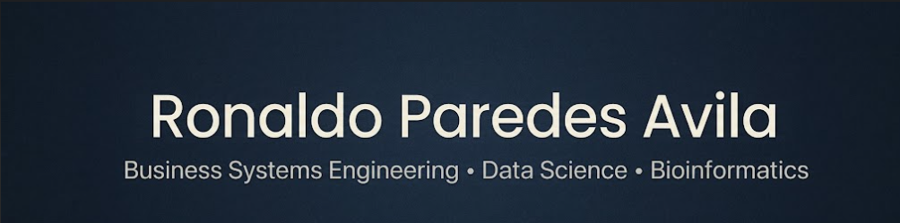

<h1 align="center">About me </h1>

Soy estudiante próximo a ser Ingeniero Empresarial y de Sistemas, Orientado al desarrollo de soluciones tecnológicas optimizadas e innovadoras. Me interesa el mundo de Data Science, el desarrollo de modelos ML, la ingeniería de datos y analítica, soluciones y arquitectura en la nube. También me entusiasma enormemente aprender sobre Bioingeniería, la fusión del software con la biología en ramas como Bioinformática, Biocomputación, etc.  

- Actualmente aprendo más sobre Machine Learning, Ingeniería de Datos, Redes neuronales, Databricks, etc.

## Skills

<h4> Languages </h4>
 
  
  
  

<h4> ML / AI </h4>

  
  
  
  

<h4> Databases </h4>

  
  
  
  

<h4> Other Tools and Technologies </h4>

  

<h4> Conexión </h4>
- 💼 **LinkedIn:** (https://www.linkedin.com/in/ronaldoparedes/)

</h4>
